# Complete Onboarding Plan

## Goal

Make Finish setup persist the legal entity, named financial year, accounting periods, named reporting setup and reporting periods, and selected income/expense categories. Earlier Continue buttons remain local-only. This is a proposed flow for review, not implementation.

## Context and Confirmed Findings

- The onboarding page holds entity, financial-year, reports, and income drafts. The expense step's Finish button currently has no submit callback; its category form state must be emitted to the page.
- The checked-in frontend `src/shared/lib/api/Api.ts` still describes combined entity onboarding. The adjacent `drimsheet-core` source and generated Swagger instead expose standalone entity, fiscal-year, accounting/reporting interval, and accounting/reporting context creation. Regenerate the client from the intended backend version before implementation; deployed availability is unverified.
- Backend interval requests accept fiscalYearId, unit, count (total period count), and ordered periods containing name only. The backend computes dates. Preserve every entered period name, and verify frontend and server period boundaries agree.
- `accountingService.switchAccountingEntity` already updates the active entity used by the API interceptor's x-accounting-entity-id header.
- Header setup atomically returns 24 required header/control accounts. Selected income and expense drafts become posting accounts beneath their matching returned parents.
- Existing categoryService.createRevenue/createExpense and accountingService.switchAccountingEntity can be reused. Creation wrappers for the new accounting endpoints and header setup are not present.

## Scope

- Expense step submit wiring, page-owned finish orchestration and pending/error/progress state.
- Regenerated API client, thin mutation hooks/services, explicit form-to-generated-DTO mappers, and a category-group-to-account-behavior configuration.
- A targeted dependency-rule exception for this onboarding page's composition of accounting and account public hooks is needed before adding cross-feature dependencies. Feature hooks/services remain within their existing ownership boundaries.
- Preserve unrelated changes, including the current income-step regression test.
- No earlier-step saving, redesign, unrelated account creation, recommendations/bootstrap extras, or backend changes are included.

## Proposed Approach

`AccountingEntityOnboardingPage.handleFinish` owns the sequence and confirmed returned IDs. It invokes the proposed `accountingOnboardingMapper` methods before calling mutation hooks. Hooks accept generated DTOs and pass them unchanged to transport services; validation remains outside mappers.

All API paths below are relative to `/api/v1`. New mapper and mutation-hook names below are proposed; useSwitchAccountingEntity and the existing categoryService methods already exist.

```mermaid
flowchart TD
  A["Finish setup<br/>ExpenseCategoriesStep → CategoriesForm.onSubmit<br/>AccountingEntityOnboardingPage.handleFinish"]
  A --> V["Validate all five drafts; lock submission<br/>Resolve required defaults before the first write"]
  V --> E["1. accountingOnboardingMapper.toEntity<br/>useCreateAccountingEntity → accountingService.createAccountingEntity<br/>POST /accounting/accounting-entity"]
  E --> S["2. Returned entityId → useSwitchAccountingEntity<br/>accountingService.switchAccountingEntity<br/>POST /accounting/accounting-entity/switch"]
  S --> H["drimsheetApi interceptor now attaches x-accounting-entity-id<br/>All remaining entity-scoped calls use this entity"]
  H --> F["3. accountingOnboardingMapper.toFiscalYear<br/>useCreateFiscalYear → accountingService.createFiscalYear<br/>POST /accounting/fiscal-year"]
  F --> AI["4. accountingOnboardingMapper.toAccountingInterval<br/>useCreateAccountingInterval → accountingService.createAccountingInterval<br/>POST /accounting/accounting-intervals"]
  AI --> AC["5. accountingOnboardingMapper.toAccountingContext<br/>useCreateAccountingContext → accountingService.createAccountingContext<br/>POST /accounting/accounting-context"]
  AC --> RI["6. accountingOnboardingMapper.toReportingInterval<br/>useCreateReportingInterval → accountingService.createReportingInterval<br/>POST /accounting/reporting-intervals"]
  RI --> RC["7. accountingOnboardingMapper.toReportingContext<br/>useCreateReportingContext → accountingService.createReportingContext<br/>POST /accounting/reporting-context"]
  RC --> HA["8. accountingOnboardingMapper.toHeaderAliases<br/>useSetupHeaderAccounts → ledgerAccountService.setupHeaderAccounts<br/>POST /ledger/header-accounts/setup"]
  HA --> INC["9. Each selected income category<br/>accountingOnboardingMapper.toRevenueCategory<br/>useCreateRevenueAccount → categoryService.createRevenue<br/>POST /ledger/revenues"]
  INC --> EXP["10. Each selected expense category<br/>accountingOnboardingMapper.toExpenseCategory<br/>useCreateExpenseAccount → categoryService.createExpense<br/>POST /ledger/expenses"]
  EXP --> OK["All writes confirmed<br/>Update/invalidate React Query caches<br/>Navigate to dashboard"]
```

Every service calls the corresponding generated `drimsheetApi.accounting.*` or `drimsheetApi.ledger.*` method. Authentication and entity-header injection stay in the existing shared transport. The switch payload is the returned entity ID directly; no form mapper is needed for it.

### Data dependencies

| Operation                  | Inputs preserved / IDs required                                                                                               |
| -------------------------- | ----------------------------------------------------------------------------------------------------------------------------- |
| Entity                     | Name, entity type, jurisdiction, functional currency                                                                          |
| Fiscal year                | entityId, entered year name, inclusive start/end dates, required status                                                       |
| Accounting interval        | fiscalYearId, grouping, count = periods.length, each accounting period name in order                                          |
| Accounting context         | fiscalYearId, accountingIntervalId, required standard/name/description                                                        |
| Reporting interval         | fiscalYearId, independent reporting grouping and ordered period names                                                         |
| Reporting context          | accountingContextId, reportingIntervalId, reporting setup name and currency                                                   |
| Header accounts            | Translated aliases for required system parents; returns parent IDs                                                            |
| Revenue/expense categories | Only selected default/custom drafts; exact displayed name, parent controlAccountId, matching behavior, isControlAccount false |

Resolve parents from returned account behavior/type, not translated names or client draft IDs. Map services/employment/grants/gifts and direct_costs/rent_utilities/bank_charges/interest to their backend behavior codes explicitly. Skip an empty selected-category list.

### Completion reads

Cache invalidation allows existing hooks to refresh after successful completion:

- useAccountingEntities → accountingService.getAccountingEntities → GET /accounting/accounting-entities.
- useAccountingEntity → accountingService.getAccountingEntity → GET /accounting/accounting-entity.
- useAccountingContexts → accountingService.getAccountingContexts → GET /accounting/accounting-contexts.
- useReportingContexts → accountingService.getReportingContexts → GET /accounting/reporting-contexts.
- Invalidate ledgerAccountService/categoryService caches as appropriate; page consumers perform their existing reads.

These reads are not prerequisites between the creation calls and must not trigger re-creation if a read fails.

## Required Defaults and Open Decisions

The form does not collect the accounting standard or accounting-context name/description, but the backend requires them. Proposed defaults: first permitted standard for the selected jurisdiction/entity type; accounting context named after the fiscal year; descriptions null; fiscal-year status open. Validate availability before creating anything. Confirm these defaults as part of reviewing the flow.

The implementation also requires the intended backend's regenerated Swagger to match the adjacent backend contract; do not implement against the stale combined request or silently drop collected names.

## Failure Handling and Risks

- These calls are separate transactions, not one atomic onboarding operation. Stop on the first failure; keep all drafts, completed-operation IDs, and completed-category receipts. Do not redirect on partial success.
- Disable repeated Finish clicks and automatic mutation retries. Retry only operations known not to have succeeded; never recreate the entity or successful categories.
- A lost response can leave an unknown server outcome. Reconcile through server reads before retrying; do not infer success or failure from a timeout. Reload-safe recovery and unambiguous identification may require backend support; the flow alone does not guarantee it.
- Keep failure messages translated and display which stage needs attention. Completion occurs only after all selected categories have been saved.

## Test Plan

- Mapper tests cover every complete generated DTO, ordered custom period names, total period counts, category parent/behavior mappings, and explicit date serialization.
- Hook/service tests cover DTO passthrough and correct endpoints/entity scope.
- Playwright covers the full Finish request order, returned-ID propagation, exact payloads, skipping unselected categories, pending protection, failures between calls, retained drafts, partial-progress retry, and completion navigation.
- Preserve tests proving all earlier Continue actions perform no writes.

## Verification

Run focused mapper/hook/service tests, onboarding Playwright tests, integration typechecking, structure/story checks, lint, and build. Browser tests use intercepted first-party APIs, never a live backend.

## Completion Criteria

All collected data is saved once under the new entity; prior steps remain local-only; selected category parents are correct; failures retain recoverable progress; successful onboarding reaches the dashboard; required checks pass; unrelated files and behavior remain unchanged.
